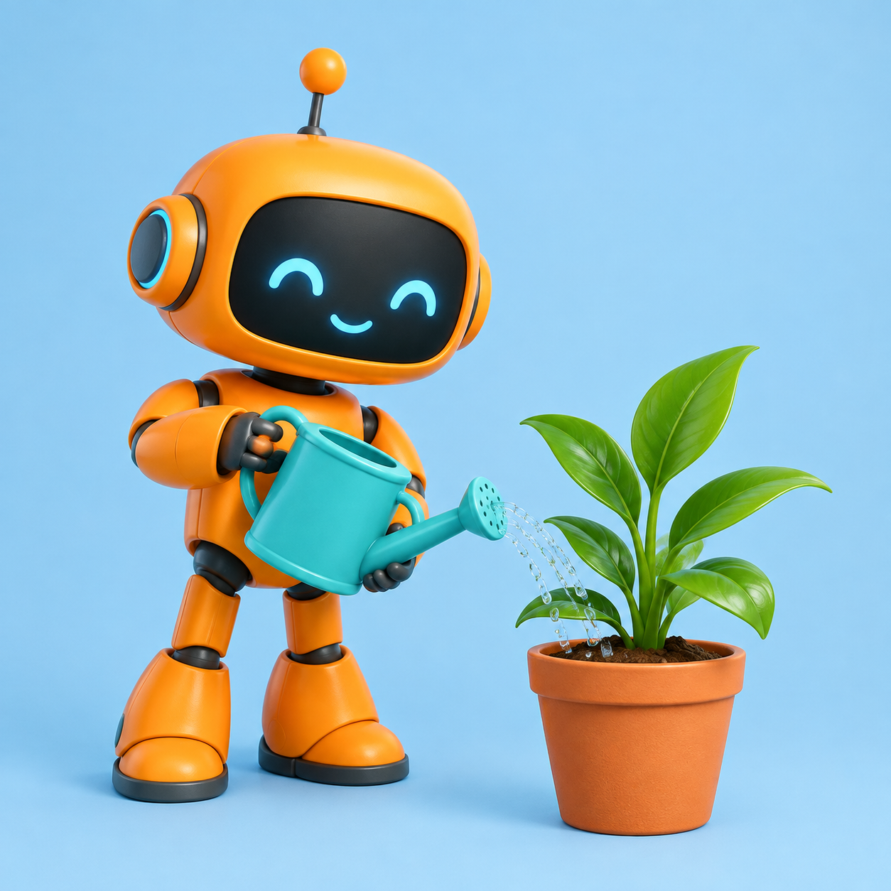
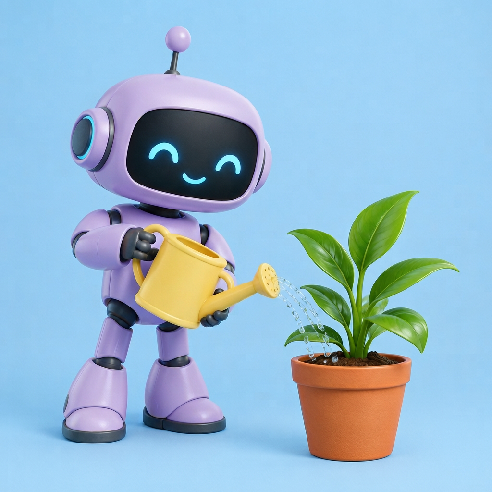

# Nano Banana Image Generator

Generate images and edit reference photos at affordable prices with the Nano Banana family. From $0.02 per 1K image. Connect your own BeatAPI key and confirm the price before generating.

[Open the Grok Bot template](https://x.ai/bot/jbcPMGNXnum5FYMLepA5P) · [Get an API key](https://beatapi.io/dashboard/apikeys) · [See current prices](https://beatapi.io/pricing)

## What you can do

Choose from the complete model family, compare the current specification and price, and generate only after approving one request. The bot resumes the same task after interruption and delivers the actual output file and link.

[Complete model catalogue and price tiers](MODELS.md)

## Get started

Install this plugin with stdio MCP support and Python 3.10+. Follow [SETUP.md](SETUP.md) to create your own BeatAPI key and supply it through the host's secure credential facility. No pip dependencies, creator key or creator workspace files are needed.

Four skills cover getting started, models and prices, generation and delivery, and the execution protocol. The bundled MCP server scopes discovery and execution to this family and never starts a demo automatically.

## Try asking

“Show me the models and current prices.”

“Help me connect my BeatAPI account securely.”

“Recommend a model for my brief, quote the price, and wait for my approval.”

## Verification

See [VERIFICATION.md](VERIFICATION.md) for real image evidence and package checks, and [GROK_APP_VERIFICATION.md](GROK_APP_VERIFICATION.md) for passed nonbillable Grok installation/host checks and their limits. Image tests do not certify every model or video generation. This is an independent BeatAPI integration.

Run the nonbillable, no-network bridge checks with `python3 -m unittest discover -s tests`.

## Actual image edit

Nano Banana 2 Lite changed the robot to lavender and the watering can to yellow. Generated through BeatAPI MCP on 2026-10-21, 1K tier, 0.02 credits settled. The reference was the GPT Image result shown below.

| Before | After |
| --- | --- |
|  |  |
